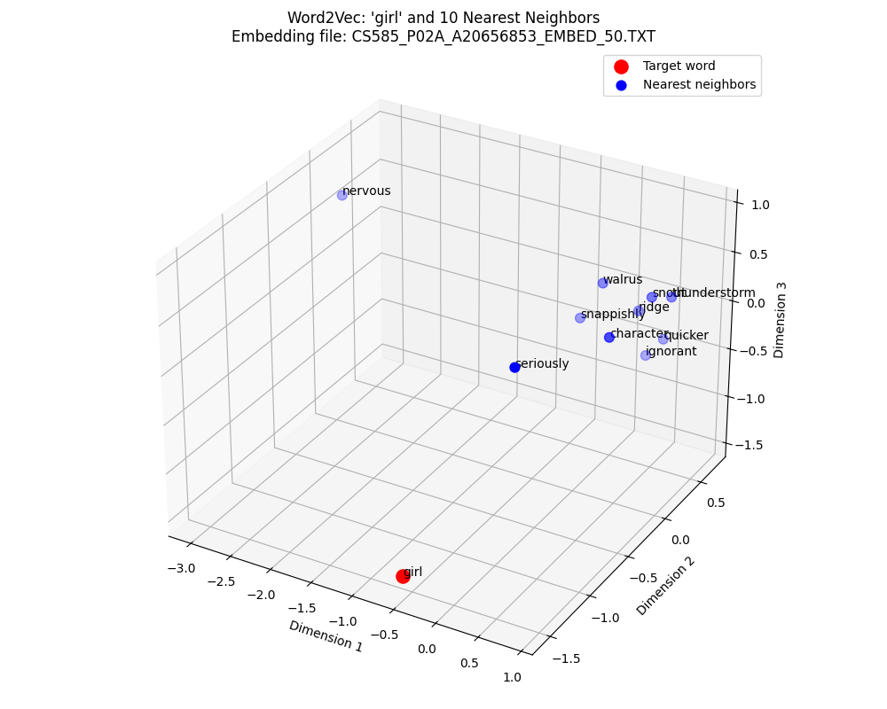
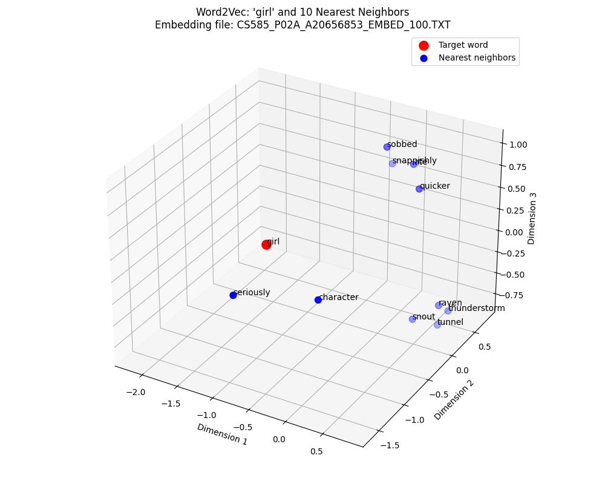
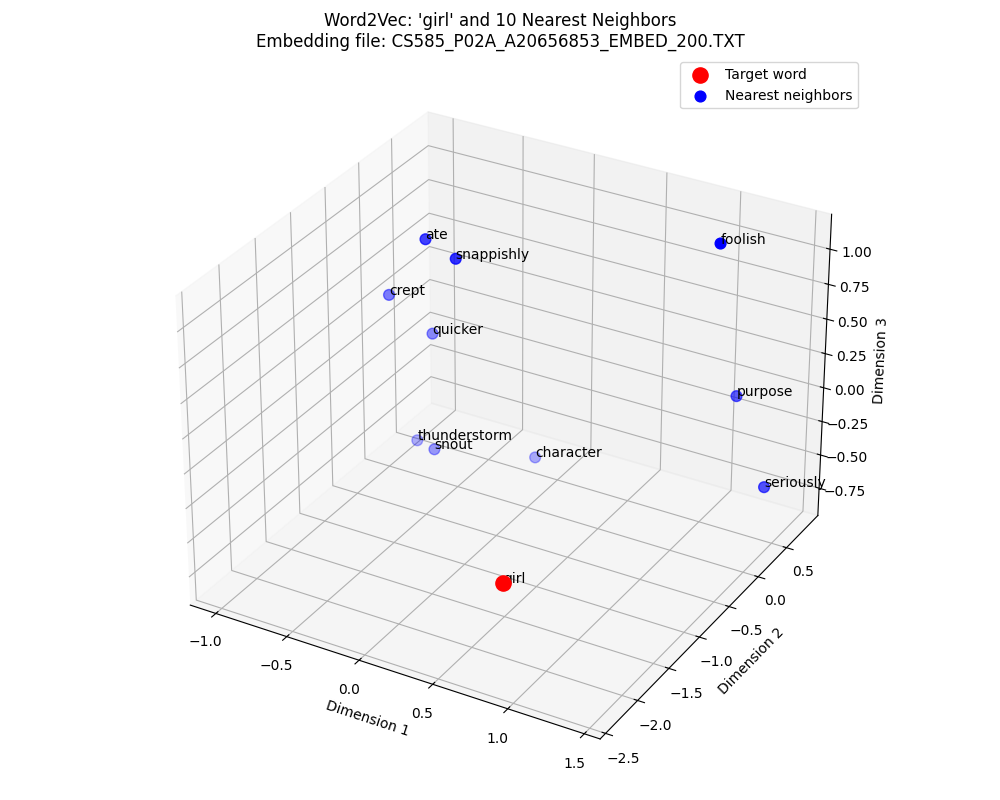

# word2vec from scratch

A skip-gram word2vec with negative sampling, written in plain NumPy with no deep-learning framework. It trains word embeddings on a text corpus, finds a word's nearest neighbors by cosine similarity, and plots them in 3D with PCA.

Built for CS 585 (Natural Language Processing) at Illinois Institute of Technology, Fall 2026.

## How it works

- **Tokenization:** every non-letter character becomes a space, the text is lowercased, and words are split on whitespace.
- **Training pairs:** for each target word, every word in a ±2 context window is a positive pair. Each positive pair gets 5 negative samples drawn from the unigram distribution raised to the 3/4 power.
- **Training:** SGD with a sigmoid/logistic loss, learning rate 0.02, 50 epochs. The target and context embeddings are separate matrices.
- **Neighbors:** cosine similarity in the original D-dimensional space, then PCA down to 3D for plotting.

## Project structure

```
├── train_word2vec.py        # train embeddings
├── nearest_neighbors.py     # query + 3D visualization
├── data/corpus.txt          # training corpus
├── embeddings/              # trained embeddings (D=50 included)
├── images/                  # example neighbor plots
└── requirements.txt
```

## Setup

```bash
python -m venv .venv
source .venv/bin/activate
pip install -r requirements.txt
```

## Usage

Train embeddings with dimension `D`:

```bash
python train_word2vec.py 50 data/corpus.txt
# -> embeddings/embeddings_D50.txt
```

Find the `K` nearest neighbors of a word (1 ≤ K ≤ 10). The embedding file is optional and defaults to `embeddings/embeddings_D50.txt`:

```bash
python nearest_neighbors.py girl 5
python nearest_neighbors.py house 5 embeddings/embeddings_D100.txt
```

Each line of an embedding file looks like `word, v1, v2, ..., vD`.

## Example results

| D = 50 | D = 100 | D = 200 |
|---|---|---|
|  |  |  |

The [images/](images/) folder also has plots for `man` and `house` at learning rates 0.01, 0.02, and 0.05.
